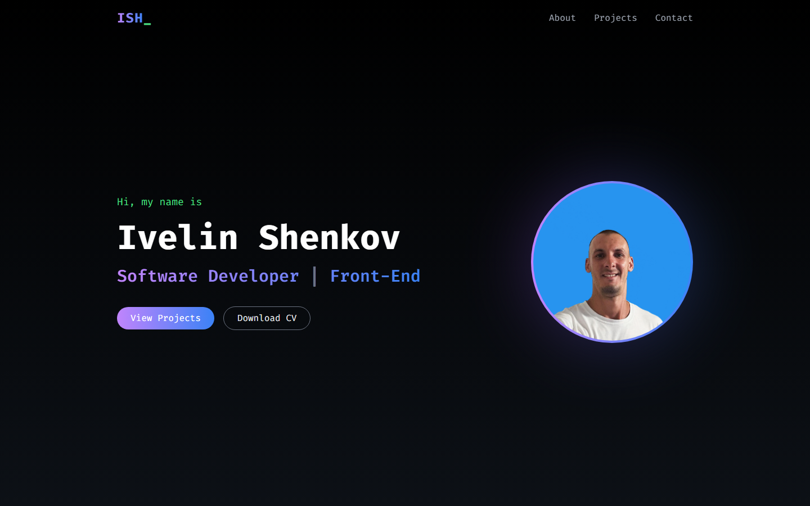
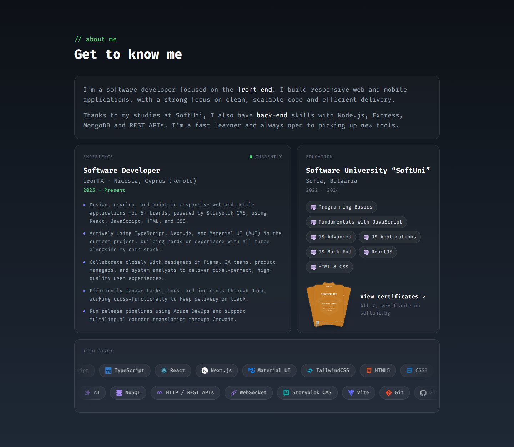
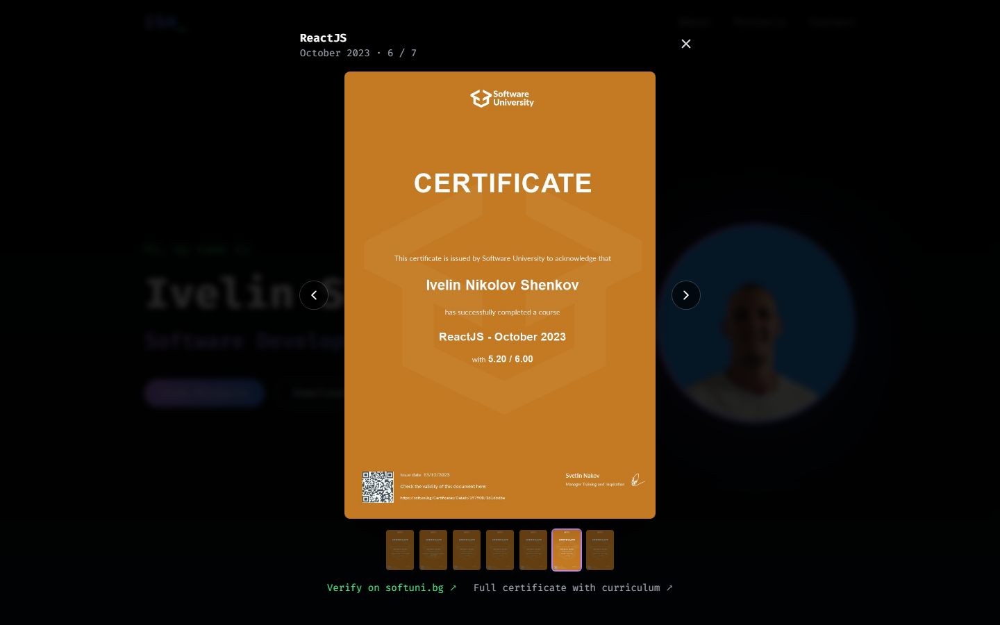
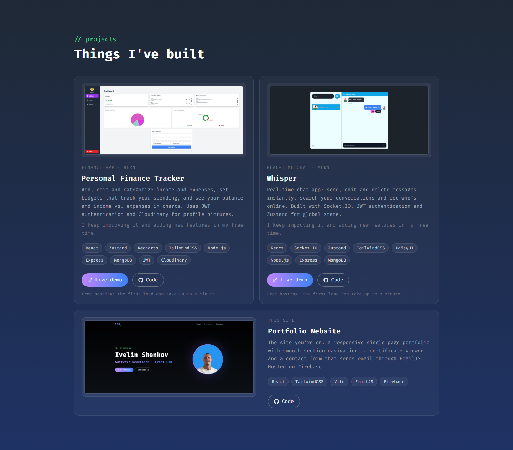
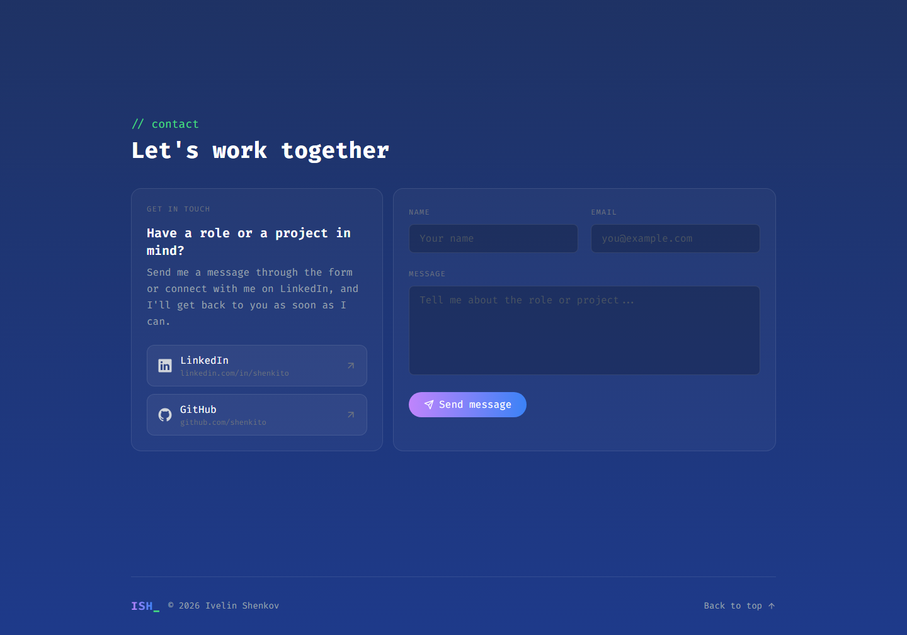
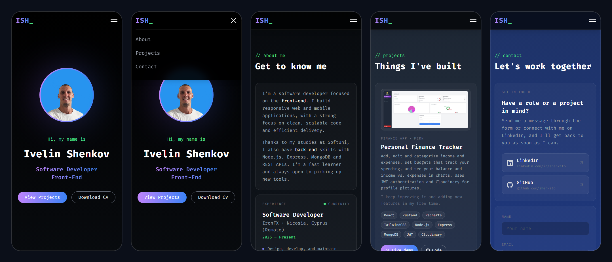
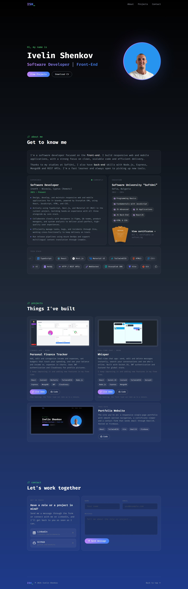

# Portfolio Website

The personal portfolio of Ivelin Shenkov, Software Developer focused on the front-end. It covers my experience, education with verifiable SoftUni certificates, tech stack and projects, and includes a contact form that sends me an email.

## Live site

[ishenk-portfolio.web.app](https://ishenk-portfolio.web.app/)

## Screenshots

### Home


### About


### Certificate viewer


### Projects


### Contact


### Mobile


### Full page
<details>
<summary>Show the whole page</summary>



</details>

## Features

- **Responsive layout**: tested on screens from 320px phones to 2560px monitors, including tablets and phones in landscape.
- **Navigation**: a navbar that highlights the section you're in, with a dropdown menu on phones and a "Back to top" link in the footer.
- **About**: experience, education and a scrolling tech stack that pauses on hover (shown as a still list for visitors who turn off animations).
- **Certificate viewer**: open any SoftUni certificate, switch between them with arrows, keyboard or swipe, and verify each one on softuni.bg.
- **Projects**: cards with screenshots, tech tags and links to the live demo and the code.
- **Contact form**: sends email through EmailJS, with "Sending...", success and error states.
- **Link previews and favicon**: Open Graph tags so shared links show a preview image, plus a custom tab icon.
- **Accessibility**: labelled form fields, keyboard support and screen-reader-friendly labels.

## Tech stack

- **Frontend**: React 18, Vite, TailwindCSS
- **Libraries**: react-icons, react-fast-marquee
- **Email**: EmailJS
- **Hosting**: Firebase Hosting

## Run it locally

```bash
cd client
npm install
npm run dev
```

The contact form needs an [EmailJS](https://www.emailjs.com/) account. Create `client/.env` with your keys:

```
VITE_EMAILJS_SERVICE_ID=your_service_id
VITE_EMAILJS_TEMPLATE_ID=your_template_id
VITE_EMAILJS_USER_ID=your_public_key
```

## Deploy

```bash
cd client
firebase deploy
```

`firebase.json` runs `npm run build` before every deploy, so the build is always up to date.
